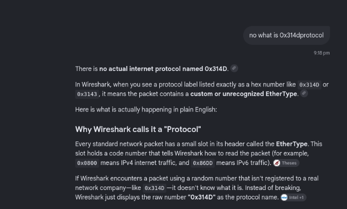
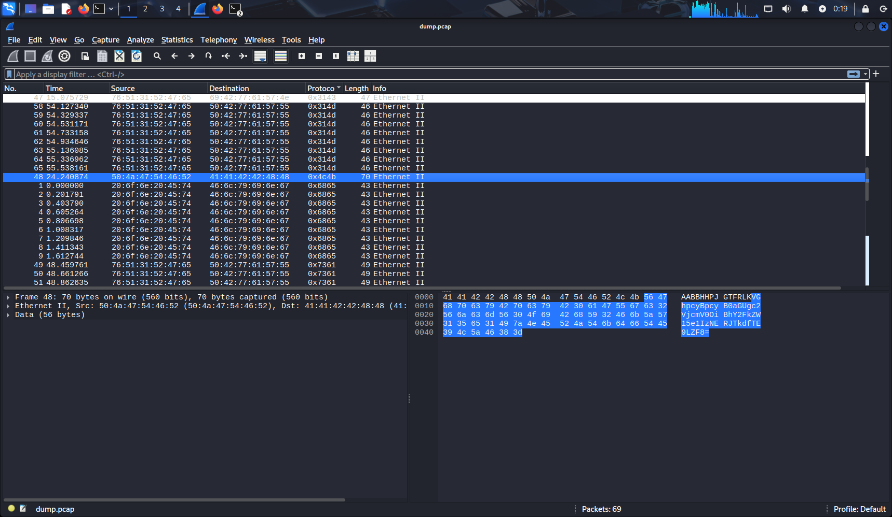
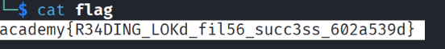

  

# FindAndOpen

## Challenge Information

|Field|Details|
|---|---|
|**CTF / Event**|picoCTF 2023|
|**Challenge Name**|FindAndOpen|
|**Category**|Forensics|
|**Difficulty**|Medium|
|**Author / Team**|Mubarak Mikail|
|**Challenge Date**|2026-11-09|

## Challenge Description

Someone might have hidden the password in the trace file. The objective is to find the key needed to unlock the provided ZIP archive.

The challenge provides two files:

- `flag.zip`: A password-protected ZIP archive.
    
- `dump.pcap`: A network packet capture containing potentially useful information.
    

**Hints provided:**

1. Download the PCAP file and look for the password or flag.
    
2. Do not use a password-cracking tool. There is an easier way.
    

## Objective

Analyze the provided PCAP file to locate the hidden password, use it to extract `flag.zip`, and retrieve the actual flag from the extracted file.

## Tools and Environment

- **Operating System:** Kali Linux
    
- **Network Analysis Tool:** Wireshark
    
- **Additional Tool:** CyberChef (for Base64 decoding)
    

## Solution Walkthrough

### Step 1: Initial Analysis

I downloaded both files provided in the challenge: `dump.pcap` and `flag.zip`.

First, I attempted to extract the ZIP archive using:

```
unzip flag.zip
```

However, the archive requested a password. Since the first hint suggested that the password might be hidden in the trace file, I decided to investigate the PCAP instead of attempting password cracking.

### Step 2: Open the PCAP File in Wireshark

I opened the packet capture in Wireshark using:

```
wireshark dump.pcap
```

Wireshark allowed me to inspect the captured packets and examine their protocol information and packet contents.

### Step 3: Investigating Unusual Protocol Values

During the investigation, I noticed several packets displaying unusual hexadecimal values in the Protocol column, including values such as `0x3143` and `0x314d`, rather than familiar protocol names.

These values were displayed as hexadecimal EtherType values in the Ethernet II frames. They did not appear as familiar, recognized protocol names in Wireshark.



I examined the packets and their data fields to look for information that could reveal the ZIP archive password.

  

### Step 4: Finding the Hidden Base64 String

While inspecting the packets, I identified a packet displaying the hexadecimal value `0x4c4b` in the Protocol column.

After opening and examining this packet, I found the following Base64-encoded string in its data:

```
VGhpcyBpcyB0aGUgc2VjcmV0OiBhY2FkZW15e1IzNERJTkdfTE9LZF8=
```

I copied the ASCII data from the packet and decoded it using CyberChef.

  

The decoded output was:

```
This is the secret: academy{R34DING_LOKd_
```

This revealed the password needed to unlock `flag.zip`. The decoded value was not the complete challenge flag; it was the password used to extract the archive.

### Step 5: Extracting the ZIP Archive and Recovering the Flag

After obtaining the password, I extracted the protected archive:

```
unzip flag.zip
```

I entered the recovered password when prompted. The archive was successfully extracted, producing a file named `flag`.

I then used the `cat` command to read the contents of the extracted file:

```
cat flag
```

The terminal displayed the following flag:

```
academy{R34DING_LOKd_fil56_succ3ss_602a539d}
```

  

## Commands Used

**1. Extract the ZIP archive**

```
unzip flag.zip
```

Attempts to extract the password-protected archive. The recovered password is entered when prompted.

**2. Open the PCAP file in Wireshark**

```
wireshark dump.pcap
```

Opens the packet capture for graphical network traffic analysis.

**3. Read the extracted flag file**

```
cat flag
```

Displays the contents of the extracted file containing the challenge flag.

## Flag / Answer

**Exact Flag:**

```
academy{R34DING_LOKd_fil56_succ3ss_602a539d}
```

**Verification Status:** Marked as verified in the source notes.

## Key Takeaways

- A PCAP file can contain useful information hidden in packet data.
    
- Unusual hexadecimal EtherType values can be worth investigating during packet analysis.
    
- Inspecting packet contents can reveal encoded information such as Base64 strings.
    
- CyberChef can be used to decode Base64 data.
    
- Password-protected archives do not always require password-cracking tools. The password may be recoverable from other challenge-provided evidence.
    

